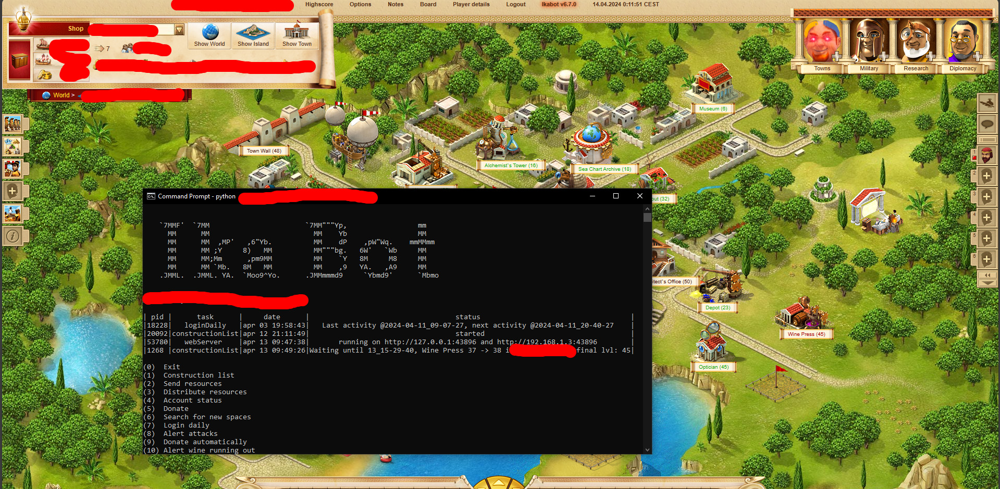

  

Ikabot is an open-source, cross-platform educational Python project for studying stateful HTTP session management, multiprocessing, and task automation using browser-strategy game mechanics as a testbed.

-[Discover the features](https://github.com/Ikabot-Collective/ikabot/wiki/Features)- 

## Concepts Demonstrated
- Stateful HTTP session and network connection management
- Cross-platform multiprocessing and background task orchestration
- Encrypted local state and session persistence
- Automated task scheduling, resource routing, and webhook notifications

## Getting Started
- Checkout the [Getting Started guide](https://github.com/Ikabot-Collective/ikabot/wiki/Getting-Started)

## Contribution Guidelines

- Before contributing code, read the [Contribution Guidelines](.github/CONTRIBUTING.md)
  - GitHub issues are for bugs and feature requests.
  - For questions, help and chat in general, join our Discord Server:

     

  
- Want to say thanks?
  - Hit the :star: Star :star: button

## Contributors

This project exists thanks to all the people who contribute.

## Screenshots

## Disclaimer

This project is developed strictly for **educational and research purposes** to explore Python networking, concurrency, and automation concepts. Ikabot is an independent open-source project and is not affiliated with, endorsed by, or sponsored by Gameforge. Automated interaction with live servers may violate third-party Terms of Service; users assume full responsibility for how they use this software.

